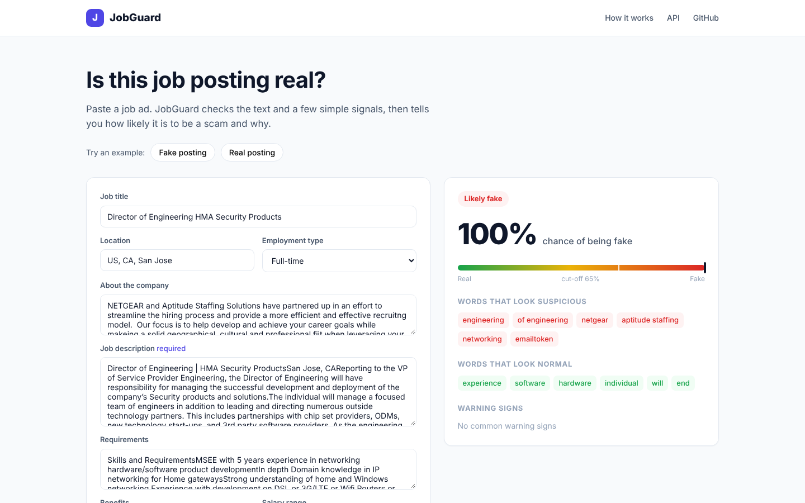
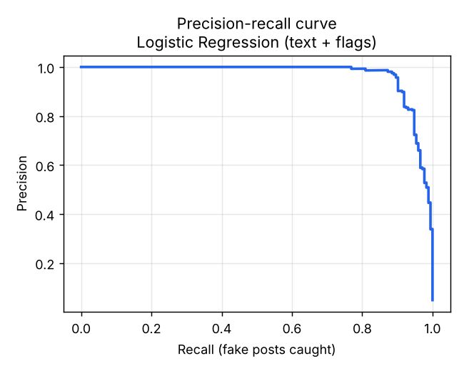
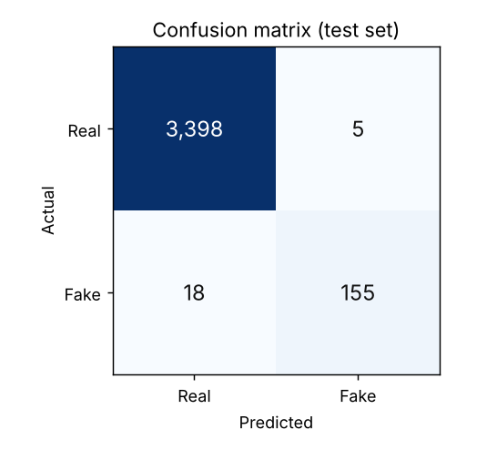

# JobGuard: Fake Job Posting Detector

A small web app that reads a job ad and estimates how likely it is to be fake. It also shows which words and which simple signals pushed the score up or down, so the result is not a black box.



## Why I built this

Fake job ads are a common way to cheat freshers out of "registration fees" or personal details. I wanted to see how well a simple, explainable NLP model can catch them, and build it end to end: data cleaning, model comparison, an API, a front end, tests and deployment.

## Results

Test set: 3,576 postings (20%, stratified), never used for training or for picking the threshold.

| Model | Precision | Recall | F1 | PR-AUC |
|---|---|---|---|---|
| Naive Bayes (text only) | 0.708 | 0.688 | 0.698 | 0.809 |
| **Logistic Regression (text + flags)** | **0.969** | **0.896** | **0.931** | **0.969** |
| Linear SVM (text + flags) | 0.957 | 0.902 | 0.929 | 0.971 |
| BiLSTM (text only, PyTorch) | 0.954 | 0.832 | 0.889 | 0.952 |

The app uses Logistic Regression. It catches about 9 out of 10 fake ads, and when it says "fake" it is right about 97% of the time.

<p>
  
  
</p>

## What I found

- **Accuracy is the wrong metric here.** Only 4.8% of ads are fake, so a model that always says "real" gets 95% accuracy and is useless. I compared models on precision, recall, F1 and PR-AUC for the fake class instead.
- **Missing information is a strong warning sign.** 17.7% of ads with no company profile were fake, compared with 1.9% of ads that had one. Ads without a company logo: 15.9% fake vs 2.0%.
- **The simple model beat the LSTM.** With only 866 fake examples, TF-IDF with two-word phrases plus a few flags worked better than a BiLSTM trained from scratch. The LSTM also only sees the first 300 words of each ad. I kept the simpler model because it is faster, smaller and easier to explain.
- **The threshold matters.** I picked the cut-off (0.65) on cross-validated predictions from the training set, not on the test set, so the test scores stay honest.

## Limitations

- The dataset is from 2012–2014 and about 60% of the ads are from the US. Scam patterns change, and Indian job portals look different.
- Some companies posted many fake ads, and the model has partly learned their names (for example "aptitude staffing" is a top fake signal). A random split rewards this. Splitting by company would give a more realistic, probably lower, score. This is the next thing I would try.
- The score is a second opinion, not proof.

## How it works

```
job ad ─► clean text (HTML, masked URLs, casing) ─► TF-IDF (1-2 word phrases)  ─┐
       └► flags: logo, company profile, questions, salary, text length ─────────┴► Logistic Regression ─► probability
                                                                                               │
                                     words with the biggest weight × TF-IDF value ◄─────────────┘  (explanation)
```

## Project structure

```
jobguard/
  data.py      cleaning and feature building (same code for training and for the app)
  train.py     trains and compares the models, tunes the threshold, saves the best one
  lstm.py      BiLSTM experiment in PyTorch (optional, not needed by the app)
  predict.py   loads the model, scores one ad, builds the explanation
  api.py       FastAPI app: /api/predict, /api/examples, /api/model, /health
static/        HTML, CSS and JavaScript front end
models/        saved model, metrics and a few example ads from the test set
reports/       charts and the LSTM scores
tests/         pytest tests (run on GitHub Actions on every push)
```

## Run it locally

```bash
python -m venv .venv
source .venv/bin/activate        # Windows: .venv\Scripts\activate
pip install -r requirements.txt
uvicorn jobguard.api:app --reload
```

Open http://127.0.0.1:8000. The interactive API docs are at http://127.0.0.1:8000/docs.

## Train it yourself

Download `fake_job_postings.csv` from Kaggle into `data/` (see [data/README.md](data/README.md)), then:

```bash
pip install -r requirements-dev.txt
python -m jobguard.lstm      # optional, about 3 minutes on a laptop CPU
python -m jobguard.train     # about 4 minutes, writes models/ and reports/
pytest -q
```

## Deploy

The repo includes `render.yaml`. On Render: New → Blueprint → pick this repo. It installs `requirements.txt` and starts the app with uvicorn. The free plan is enough.

## Data

Employment Scam Aegean Dataset (EMSCAD), University of the Aegean, published on Kaggle as "[Real or Fake] Fake JobPosting Prediction". 17,880 job ads, 866 labelled fake.

## Tech

Python, pandas, scikit-learn, PyTorch (experiment only), FastAPI, Pydantic, HTML/CSS/JavaScript, pytest, GitHub Actions, Render.
